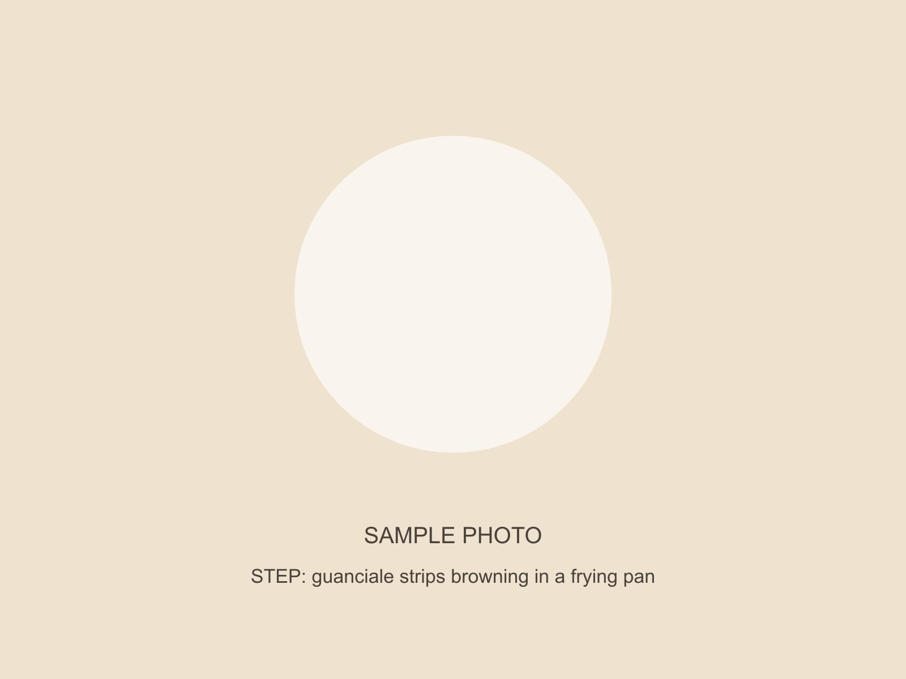
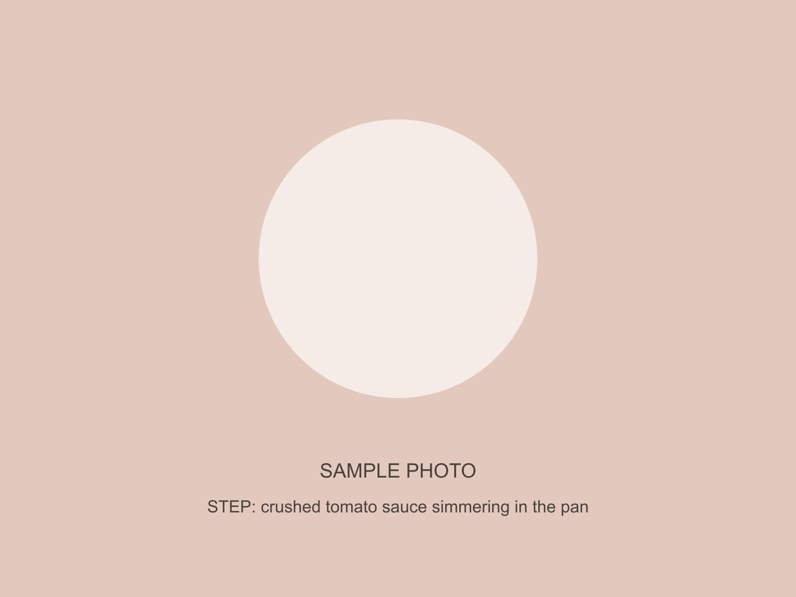


アマトリチャーナは、ローマの近くの町アマトリーチェで生まれたパスタです。
去年ローマで食べたときにとてもおいしくて、家でも作りたくなりました。



ブカティーニ | 160g | スパゲッティ
グアンチャーレ | 80g | パンチェッタ
ホールトマト缶 | 1/2缶（200g）
ペコリーノ・ロマーノ | 40g
白ワイン | 大さじ2
赤唐辛子 | 1本



グアンチャーレを1cm幅の棒状に切ります。

フライパンに油をひかずにグアンチャーレを入れ、弱火にかけます。
脂が出てカリッとするまで、5分ほどじっくり炒めます。

赤唐辛子を入れ、白ワインを加えます。
アルコールをとばします。

ホールトマトをつぶしながら入れ、10分煮ます。

パスタを、表示時間より1分短くゆでます。

ゆでたパスタをソースに入れてからめます。
ゆで汁を少し足します。

火を止め、ペコリーノをかけて混ぜます。



### 油はひかない
グアンチャーレから出る脂だけで十分です。
フライパンに油をひかずに炒めてください。

### グアンチャーレは弱火で
グアンチャーレを焦がすと、ソースが苦くなります。
弱火で、じっくり脂を出しましょう。

### 玉ねぎは入れない
このレシピでは玉ねぎを入れません。
玉ねぎを入れるレシピもあります。



材料はシンプルですが、グアンチャーレの脂がソースのおいしさを決めます。
弱火でじっくり炒めるところを、ていねいにやってみてください。

