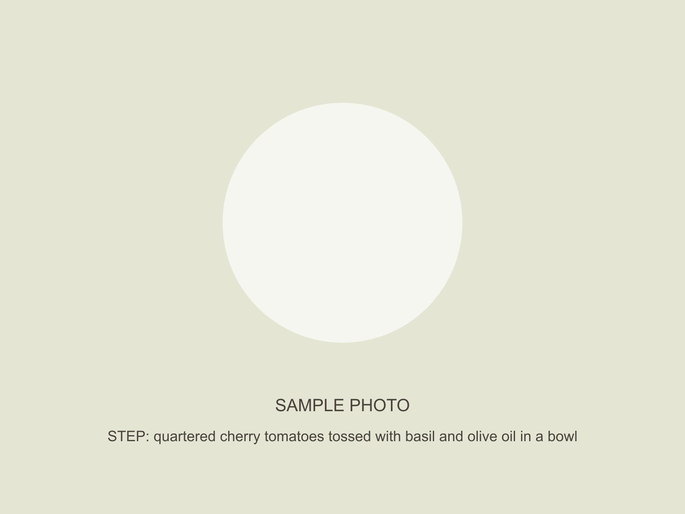
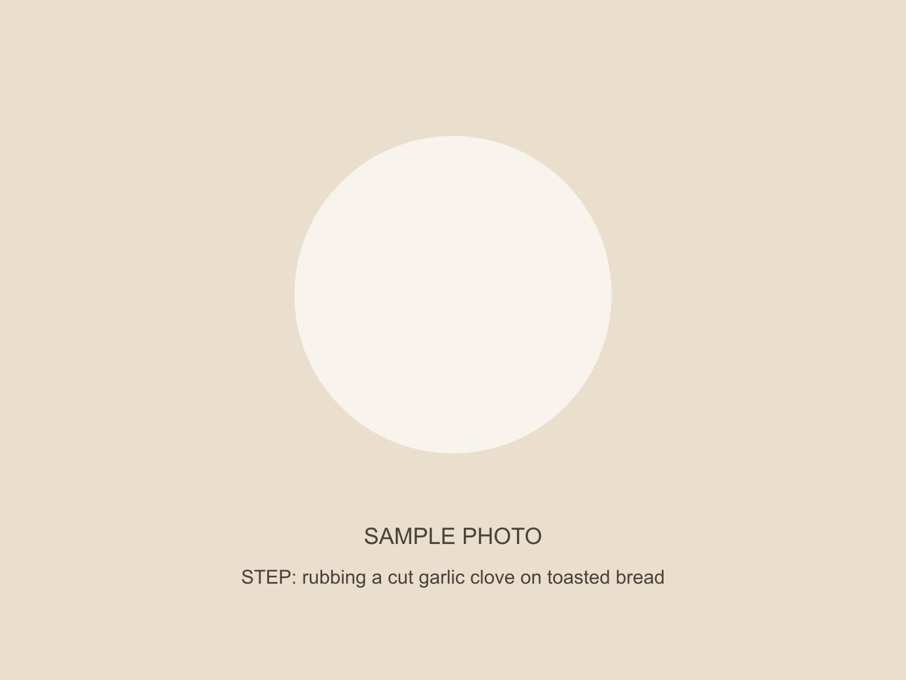


ブルスケッタは、焼いたパンにトマトをのせて食べる前菜です。
夏の終わりにミニトマトをたくさんもらったので作りました。



バゲット | 1cmの厚さで4枚
ミニトマト | 10個
にんにく | 1かけ
バジル | 4〜5枚
オリーブオイル | 大さじ2
塩 | ひとつまみ



ミニトマトを4つ割りにします。
塩、オリーブオイル、ちぎったバジルとあえて、10分おきます。

その間に、バゲットをトースターでこんがり焼きます。

にんにくを切り、切り口をパンにこすりつけます。

トマトを汁ごとパンにのせて、できあがりです。



### トマトには先に塩をする
先に塩をしておくと、トマトから水分が出ます。
その水分で、味がよくなじみます。

### にんにくは焼きたてのパンに
パンが冷めると、にんにくの香りがうつりにくくなります。
焼きたてのうちに、すぐこすりつけましょう。



トマトの汁がしみたパンと、にんにくの香りがよく合います。
トマトがたくさんあるときに、ぜひ作ってみてください。

