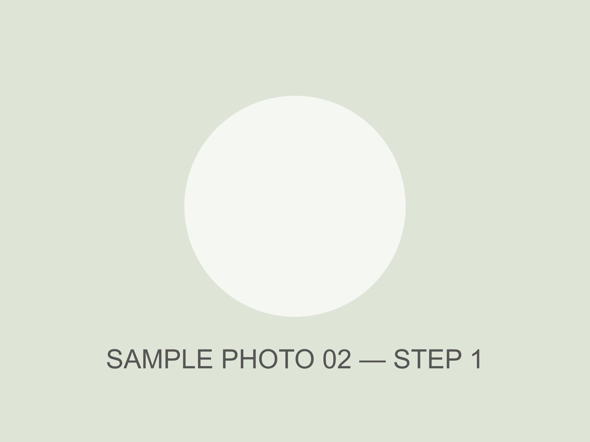
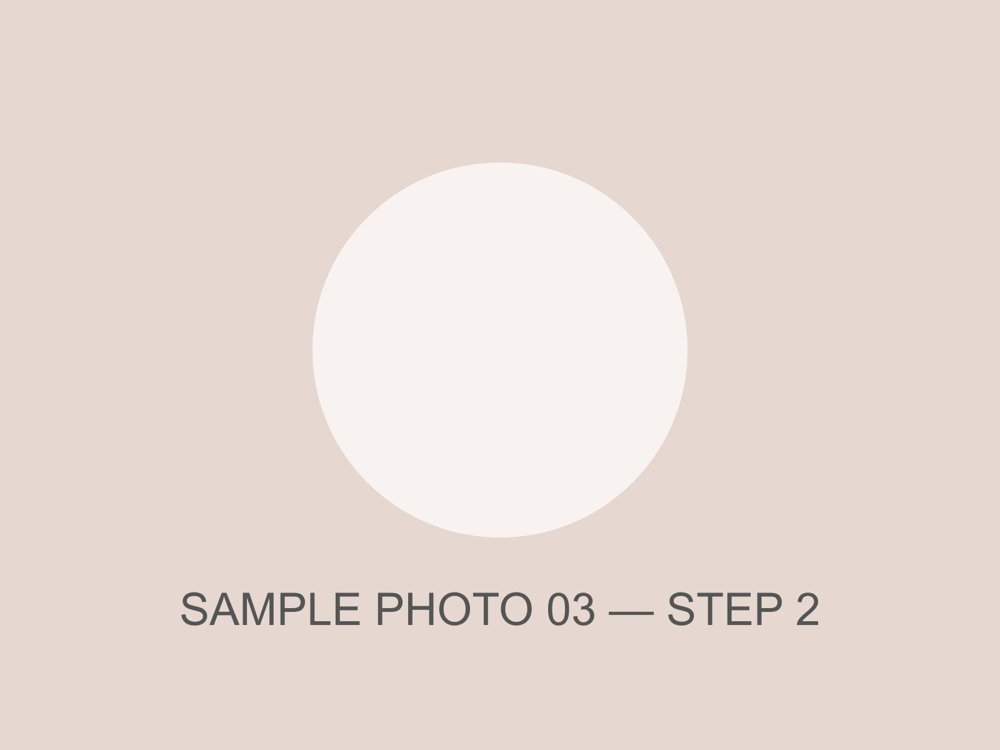


カチョ・エ・ペペは、チーズと黒こしょうで作るローマのパスタです。
材料が少ないので、思い立ったらすぐ作れます。
最初はチーズがダマになって失敗しましたが、何度か作るうちにコツがわかってきました。



スパゲッティ | 160g
ペコリーノ・ロマーノ（すりおろす） | 60g | パルミジャーノ・レッジャーノ
黒こしょう（粒） | 小さじ1
塩（ゆで用） | 水1Lに対して小さじ1



黒こしょうをすり鉢などで粗くつぶします。
フライパンで弱火にかけ、香りが立つまで1分ほど乾煎りします。

鍋にお湯を沸かして塩を入れ、スパゲッティを表示時間より1分短くゆでます。
ゆで汁はあとで使うので、お玉2杯分を取っておきます。

ボウルにチーズを入れ、少し冷ましたゆで汁を大さじ2ずつ加えて混ぜます。
とろりとしたペースト状になればOKです。

黒こしょうのフライパンにスパゲッティとゆで汁お玉1杯を入れ、火を止めます。
チーズのペーストを加えて、手早く全体にからめます。

お皿に盛り、残りの黒こしょうとチーズをふって完成です。



### チーズは必ず火を止めてから
フライパンが熱いままだと、チーズが固まってダマになります。
火を止めて、少し温度が下がってから加えてください。

### ゆで汁は少しずつ
ゆで汁を一度に入れると、ソースが水っぽくなります。
様子を見ながら、少しずつ足すのが失敗しないコツです。



材料が少ないぶん、温度とゆで汁の量で仕上がりが変わります。
はじめは少なめの量で作って、ちょうどよいとろみを見つけてみてください。

