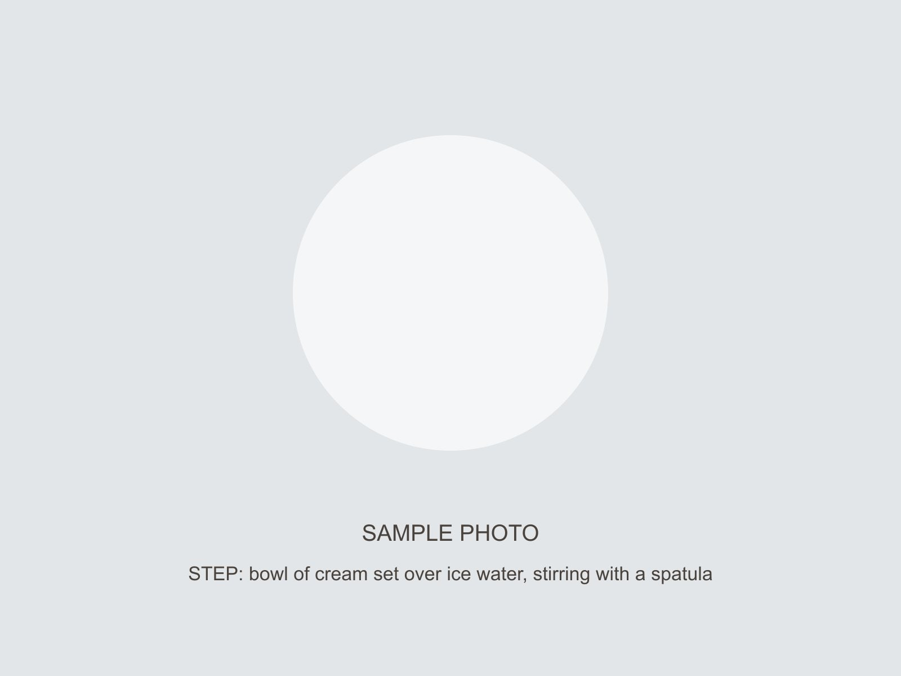


パンナコッタは、イタリアのピエモンテ州のお菓子です。
材料が少なく、混ぜて冷やすだけで作れます。
おもてなしのデザートによく作っています。
冷蔵庫で冷やす時間が、別に3時間以上かかります。



生クリーム | 200ml
牛乳 | 100ml
砂糖 | 30g
板ゼラチン | 5g
バニラエッセンス | 少々



板ゼラチンを冷水に5分つけて、ふやかします。

鍋に生クリーム、牛乳、砂糖を入れます。
沸騰する直前まで温めます。

火を止め、水気をしぼったゼラチンを入れて溶かします。
バニラエッセンスも加えます。

ボウルに移し、底を氷水にあてます。
とろみがつくまで、混ぜながら冷まします。

カップに入れ、冷蔵庫で3時間以上冷やします。



### とろみがつくまで冷ましてから
とろみがついてからカップに入れると、バニラが底に沈みません。

### 沸騰させない
沸騰させてしまうと、ゼラチンが固まりにくくなります。
温めるのは、沸騰する直前までにしてください。



作業は20分ほどで、あとは冷蔵庫で冷やすだけです。
冷まし方と火加減に気をつけて、なめらかに仕上げてみてください。

